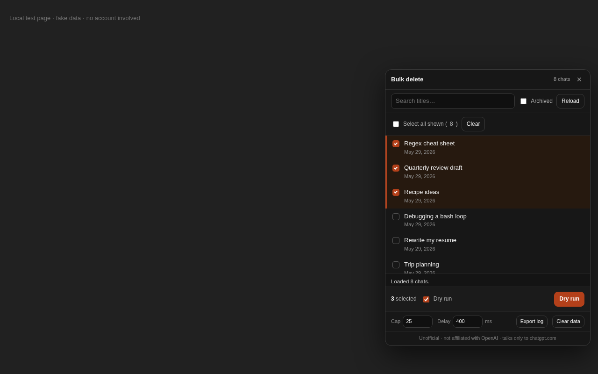
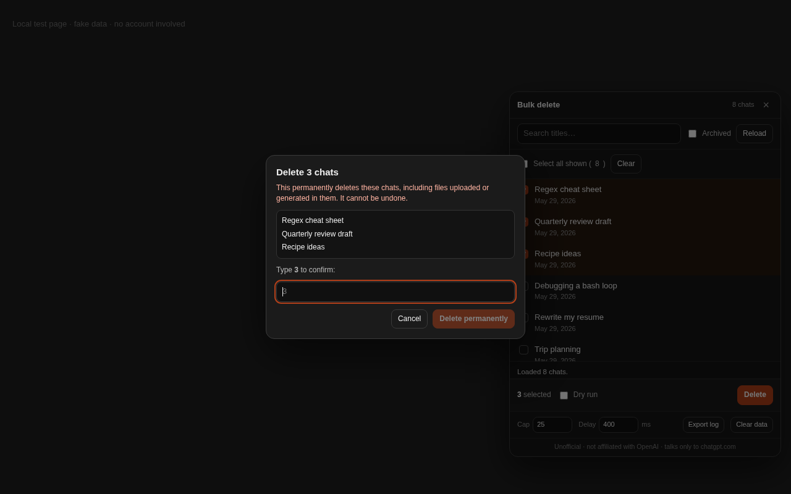

# How to use

This guide is written in plain English. You don't need any technical knowledge.

Three things to remember:

1. A **dry run** is a practice run. It deletes nothing.
2. You choose the chats. Nothing is deleted unless you tick it and confirm.
3. Deleting cannot be undone, so make a backup first.

---

## 1. Make a backup first

Deleting a chat is permanent. Before a big cleanup, ask ChatGPT for a copy of your
data. It is free and it is the only way back.

1. Open `chatgpt.com` and log in.
2. Click your name at the bottom left, then **Settings**.
3. Open **Data controls** and click **Export data**.
4. Confirm, then wait for the email. It usually arrives in minutes, sometimes a day.
5. Download the file and keep it somewhere safe.

If you only delete one or two test chats, you can skip this.

---

## 2. Install

### Firefox, easy way

Once the add-on is approved by Mozilla, you install it like any other extension:
open its page on addons.mozilla.org, click **Add to Firefox**, then **Add**. Updates
arrive by themselves.

If that page is not ready yet, use the manual way below.

### Firefox, manual way

1. Go to the **Releases** page of the project.
2. Download the file ending in `firefox.zip`.
3. Unzip it. You should get a folder containing `manifest.json`, `src`, and `icons`.
4. In the Firefox address bar, type:
   ```
   about:debugging#/runtime/this-firefox
   ```
5. Click **Load Temporary Add-on…**
6. Choose the `manifest.json` file inside the folder you unzipped.
7. The add-on now appears in the list.

Firefox forgets temporary add-ons when it closes. That is normal. Next time, repeat
steps 4 to 6. It takes ten seconds.

### Chrome, Edge, or Brave

1. Go to the **Releases** page and download the file ending in `chrome.zip`.
2. Unzip it. You should get a folder containing `manifest.json`, `src`, and `icons`.
3. In the address bar, type:
   ```
   chrome://extensions
   ```
4. Turn on **Developer mode**, top right.
5. Click **Load unpacked** and choose the folder you unzipped.
6. Chrome may warn you that developer-mode extensions are running. You can ignore it.

### Finish installing

Go to `chatgpt.com` and press **Ctrl+R** to reload the page. The add-on only starts
working after a reload.

---

## 3. Open the panel

Look at the bottom right corner of `chatgpt.com`. You will see a small red button
that says **Bulk delete**.

Click it. A panel opens with your chats, each with a tick box.

If the list is empty, click **Reload** inside the panel. If some of your chats are
archived, tick the **Archived** box to show them too.



---

## 4. Practice first (dry run)

**Dry run is on by default.** In this mode the add-on sends no delete requests at
all. It only shows you what it would do.

1. Create two throwaway chats: click **New chat**, type `test one`, send. Do the
   same for `test two`.
2. In the panel, click **Reload** so the new chats appear at the top.
3. Tick both of them.
4. Click the **Dry run** button at the bottom.
5. A window lists the two chats. Click **Run dry run**.

You should see:

```
Dry run: 2 of 2 would be deleted. No requests sent.
```

Nothing was deleted. Close the panel with **×** or the **Esc** key when you are done.

---

## 5. Delete for real

Only do this when the practice run above worked.

1. Untick the **Dry run** box. The bottom button now says **Delete**.
2. Tick the chats you want to remove.
3. Click **Delete**. A window lists exactly the chats you picked.
4. Type the number of chats in the box. For two chats, type `2`.
5. The red **Delete permanently** button becomes clickable. Click it.
6. Wait. Each chat is deleted one at a time.

When it finishes, the status line says something like:

```
Done: 2 deleted, 0 failed of 2. Server total 66 → 64 (Δ2).
```

The number after **Δ** is how many chats disappeared from your account. It should
match the number you deleted. If it does not, stop and open an issue on GitHub.



---

## 6. Cleaning up many chats

You do not have to delete everything in one go. Small batches are easier to check.

- **Tick a range:** click the first chat, then hold **Shift** and click the last one.
- **Find chats:** type in the search box. It filters as you type.
- **Select many at once:** **Select all shown** ticks everything currently visible.
  It only affects what the search and Archived filters are showing.
- **Change your mind:** **Clear** removes all ticks.
- **Limit the batch:** **Cap** is the maximum number of chats one run may delete.
  The default is 25. The add-on refuses a bigger selection, which protects you from
  a misclick.
- **Slow down:** **Delay** is the pause between requests, in milliseconds. If you see
  a rate-limit message, wait a minute and raise the delay.

After every batch, read the status line and make sure the number after **Δ** matches
what you deleted.

---

## 7. What the buttons do

| Control | What it does |
|---|---|
| **Search** | Shows only chats whose titles match what you type. |
| **Archived** | Also loads your archived chats. |
| **Reload** | Fetches the list again from ChatGPT. |
| **Select all shown** | Ticks every chat currently visible. |
| **Clear** | Unticks everything. |
| **Dry run** | Practice mode. No delete requests are sent. |
| **Cap** | Maximum chats per run. Default 25. |
| **Delay** | Pause between delete requests. Default 400 ms. |
| **Export log** | Downloads what happened in this session as a JSON file. |
| **Clear data** | Deletes the add-on's saved settings and last-run counts. |

The action log is kept in memory only. **Export log** writes it to a file if you
want a record. It contains titles, so keep it private.

---

## 8. If something looks wrong

| What you see | What to do |
|---|---|
| No red button | Reload `chatgpt.com`. Check the add-on is listed in `about:debugging` (Firefox) or `chrome://extensions` (Chrome). |
| "No access token returned" | You are logged out or the page is out of date. Reload and log in. |
| "Unauthorized (401)" | Your login session expired. Reload the page. |
| "Rate limited (429)" | Wait a minute. Then use a smaller batch and a larger delay. |
| The chat list is empty | Click **Reload**. If your chats are archived, tick **Archived**. |
| The number after Δ does not match | Stop deleting. Note the numbers and open a GitHub issue. |
| Everything broke after a ChatGPT update | OpenAI changed something. Open an issue with the message you see; it contains no personal data. |

---

## 9. Removing the add-on

- **Firefox, one-click install:** open `about:addons`, find the add-on, click the
  three dots, then **Remove**.
- **Firefox, manual install:** open `about:debugging#/runtime/this-firefox`, find the
  add-on, then click **Remove**. Or just close Firefox.
- **Chrome:** open `chrome://extensions`, then click **Remove**.

Saved settings are deleted with the add-on. You can also click **Clear data** in the
panel first. Removing the add-on never touches your chats.
