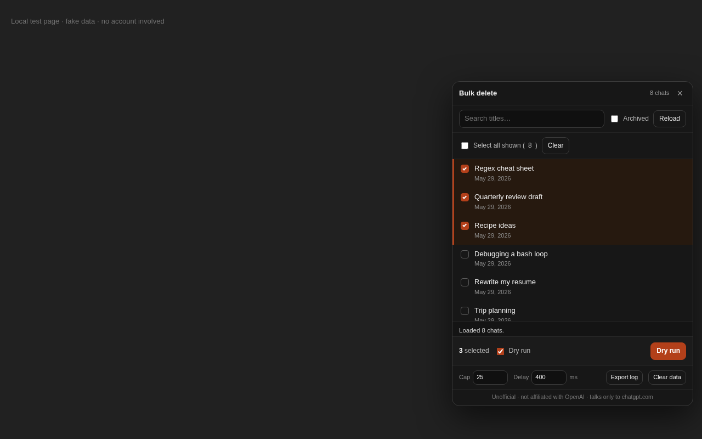

# Bulk Delete for ChatGPT

[](https://github.com/Aashutosh31/bulk-delete-for-chatgpt/actions/workflows/ci.yml)
[](LICENSE)

A small browser extension that turns your ChatGPT history into a checkbox list, so
you can permanently delete the chats you pick — one at a time, only the ones you
ticked.

**Unofficial. Not affiliated with OpenAI.**



## Why this exists

Most bulk-delete extensions ask for broad permissions and then run code you cannot
inspect. This one is four JavaScript files, no minification, no build step, no
server, and no analytics. It talks to `chatgpt.com` and nothing else. You can read
every line in a few minutes.

- **No telemetry, no accounts, no server.** Nothing leaves your browser.
- **Token never stored.** It is read from `/api/auth/session` in the page at the
  start of each run and kept in memory only.
- **Delete only what you tick.** There is no "delete all", "delete filtered", or
  date-based rule anywhere in the code. One request per conversation.
- **Dry run by default.** The first button press changes nothing.
- **Typed confirmation.** You type the number of selected chats.
- **Tested.** An end-to-end suite runs the extension against a fake `chatgpt.com`
  and asserts that only the ticked IDs are deleted.

## Features

- Checkbox multi-select with **Shift+click** range selection.
- Search, plus an **Archived** toggle.
- "Select all shown" applies only to the current filter, and shows the count.
- Per-conversation progress, **Abort** between requests.
- Stops on `401`/`429`; retries once on transient `5xx`.
- After each run: re-reads the server total and checks it dropped by exactly the
  number of successful deletes (`Server total 312 → 300 (Δ12)`).
- Local action log, exportable as JSON. Stored in memory only.

## Install

### Firefox (recommended)

**Permanent (signed, unlisted):** download the `.zip` from
[Releases](https://github.com/Aashutosh31/bulk-delete-for-chatgpt/releases),
then sign it as an unlisted add-on following
[docs/PUBLISHING.md](docs/PUBLISHING.md) (free, needs an AMO account), and install
the resulting `.xpi`.

**Temporary (no account needed):**

1. Download and unpack `bulk-delete-for-chatgpt-firefox-<version>.zip`.
2. Open `about:debugging#/runtime/this-firefox`.
3. **Load Temporary Add-on…** → pick the unzipped `manifest.json`.
4. Reload `https://chatgpt.com`.

Temporary add-ons disappear when Firefox restarts.

### Chrome / Chromium / Brave / Edge

1. Download and unpack `bulk-delete-for-chatgpt-chrome-<version>.zip`.
2. Open `chrome://extensions` → enable **Developer mode**.
3. **Load unpacked** → select the unzipped folder.
4. Reload `https://chatgpt.com`.

## Use

1. Click the **Bulk delete** pill at the bottom right of `chatgpt.com`.
2. Press **Reload**, then try **Dry run** (on by default). Nothing is deleted.
3. Untick **Dry run**, select chats, press **Delete**, type the count.

Click-by-click instructions, including screenshots and troubleshooting:
**[HOW-TO-USE.md](HOW-TO-USE.md)**.

## Permissions

| Permission | Why |
|---|---|
| `host_permissions: https://chatgpt.com/*` | It runs on one site and only contacts that site. |
| `storage` | Remembers the batch cap, delay, and dry-run toggle, plus counts from the last run. |

No `<all_urls>`, no `tabs`, no `webRequest`, no remote scripts, no `eval`.

## What it stores

`chrome.storage.local`:

```jsonc
{
  "cgb.settings": { "cap": 25, "delay": 400, "dryRun": true },
  "cgb.lastRun":  { "finishedAt": 1760000000000, "requested": 12, "deleted": 12, "failed": 0, "dryRun": false }
}
```

No titles, no conversation IDs, no tokens. **Clear data** in the panel removes both.
Details: [PRIVACY.md](PRIVACY.md).

## How it works

| Step | Request |
|---|---|
| Session | `GET /api/auth/session` → access token, in memory only |
| List | `GET /backend-api/conversations?offset=…&limit=…&order=updated` (paged) |
| Delete | `DELETE /backend-api/conversation/id/{id}?delete_generated_artifacts=true&delete_uploaded_artifacts=true` |

These are the same calls the web UI makes. They are undocumented and can change
without notice; if that happens, capture the new request and open a PR.

## Limits

- **Permanent.** Deleting a chat cannot be undone in the UI. Download your official
  export first (`Settings → Data controls → Export data`).
- Deleting a chat also deletes files uploaded to or generated inside it, matching
  the UI's own Delete.
- Deleting a shared chat breaks its share link.
- A chat in a Project leaves the Project; the Project itself is untouched.
- Temporary chats never appear in history.
- Heavy use may hit OpenAI rate limits; keep the delay at the default or higher.

## Development

```bash
npm ci
npm run build      # build/firefox, build/chrome, dist/*.zip
npm test           # manifest checks, privacy guard, e2e, layout
npm run screenshots
```

The e2e suite serves a self-signed fake `chatgpt.com` on `127.0.0.1:8443`, maps the
hostname in Chrome, and drives the real extension. It never contacts your account.

Branded Chrome 137+ ignores `--load-extension`, so the tests need Chromium or Chrome
for Testing. If neither is on your `PATH`:

```bash
npx @puppeteer/browsers install chrome@stable   # prints the binary path
CHROME_PATH=/that/path npm test
```

## Contributing

Issues and PRs welcome. Please read [CONTRIBUTING.md](CONTRIBUTING.md) first — the
short version is: no telemetry, no new permissions without discussion, no remote
code, and `npm test` must pass.

Security reports: [SECURITY.md](SECURITY.md).

## License

MIT © Aashutosh Bairagi. See [LICENSE](LICENSE).

ChatGPT is a trademark of OpenAI. This project is not affiliated with, endorsed by,
or sponsored by OpenAI.
